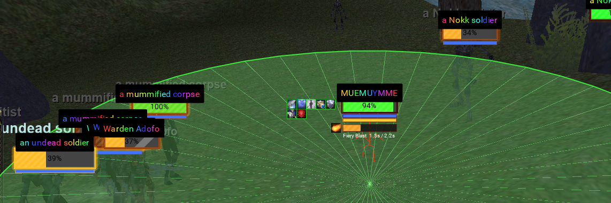
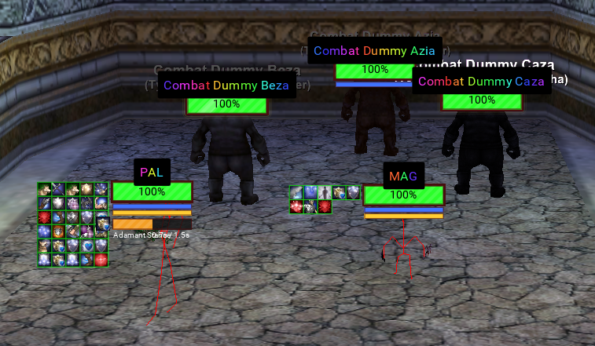
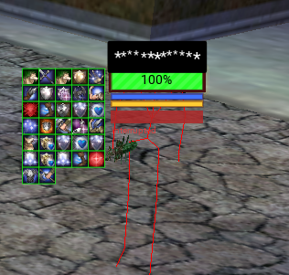

# MQEQGFX

MQEQGFX is a MacroQuest plugin that exposes the EverQuest 3D world to Lua. Your scripts get the game's own camera and renderer: convert world coordinates to screen pixels, draw lines, circles, arcs, and rects in the world, look up spell shapes, and read combat events as they happen. The included nameplates, spell indicators, and damage numbers scripts are examples of what you can build with it.



## Getting Started

```txt
/plugin MQEQGFX
```

Then require the module from any Lua script and start drawing. This complete script draws a red ring under your target:

```lua
local mq    = require('mq')
local eqgfx = require('eqgfx')

local ok, err = eqgfx.init()
if not ok then print('eqgfx: ' .. tostring(err)) return end

while true do
  eqgfx.clear()
  local t = mq.TLO.Target
  if t.ID() and t.ID() > 0 and t.X() then
    eqgfx.add_circle(t.X(), t.Y(), t.Z(), 15, eqgfx.argb(200, 255, 60, 60))
  end
  mq.delay(50)
end
```

The main entry points:

```lua
eqgfx.init()                                 -- true when the engine is ready to draw
eqgfx.clear()                                -- empty the scene, then add_* what should exist now
eqgfx.add_circle(x, y, z, radius, color)
eqgfx.add_arc(cx, cy, cz, radius, startRad, endRad, color)
eqgfx.add_line(x1,y1,z1, x2,y2,z2, color)
eqgfx.add_screen_rect(x0,y0, x1,y1, color)   -- raw pixels, no projection
eqgfx.argb(a, r, g, b)                       -- colors, 0-255 each

local sx, sy, visible = eqgfx.world_to_screen(x, y, z)
local geom  = eqgfx.spell_geom(spellID)      -- targetType, range, aeRange, cone angles
local casts = eqgfx.poll_casts()             -- cast starts: spellID, spawnID, castTimeMs
local hits  = eqgfx.poll_damage()            -- hits/heals/misses: attackerID, targetID, damage, ...
```

Pass TLO coordinates as they are. The `add_*` primitives draw under the EQ windows automatically. For text, icons, and filled shapes, get pixels from `world_to_screen` and draw with MQ's ImGui. **[docs/CORE_API.md](docs/CORE_API.md)** covers all of it with working examples.

To track other spawns' casts (cast bars, AE warnings), use the `require('eqgfx.casts')` library: it auto-selects the plugin cast feed when that's live and falls back to the "begins to cast" chat line otherwise, so it works on every build, gives spell names and interrupts, and each script gets its own copy. `poll_casts()` is a single-consumer raw feed that drains on read, so it is best used by one dedicated aggregator script rather than shared across scripts.

### Example scripts

Three example scripts ship with the plugin. They are fully usable as is, and they show what the API can do:

```txt
/lua run eqgfx/nameplates      animated nameplates with cast bars and AE highlighting
/lua run eqgfx/indicators      spell areas drawn on the ground
/lua run eqgfx/dmgnums         floating damage numbers
```

Each has an in-game settings menu (`/npmenu`, `/aemenu`, `/dnmenu`). Nothing is configured in files.

 

### Commands

**Plugin** (`/eqgfx`) — available whenever `MQEQGFX` is loaded:

```txt
/eqgfx                                   status: build stamp, screen size, draw counters, event queues
/eqgfx dmgdebug [off]                    chat-log each raw hit/heal report (for debugging poll_damage)
/eqgfx portrait self|target [on|off]     experimental: 3D portrait in the player/target window
/eqgfx showmodel [off|<armor>]           experimental: model viewer window (<armor> = plate|chain|cloth|leather|ring|scale)
/eqgfx capture [off|save|clear|status]   experimental: record/replay a character's worn appearance
/eqgfx dumpchar                          experimental: dump your character's appearance data to chat
/eqgfx dumpmodel                         experimental: dump the loaded model's data to chat
```

The example scripts bind their own commands, only while the script is running:

**nameplates** (`/lua run eqgfx/nameplates`):

```txt
/npmenu                 open/close the settings window
/npradius <n>           set the plate detection radius
/nppcs                  toggle showing PC plates
/npui                   list the EQ windows the occlusion scan detects
/npui show              toggle the occluder-rect overlay
/npui add <Name>        add a window to the occlusion scan (find names with /windows)
/npdebug                print a full health report: render caps, occlusion source, target buff scan
```

**indicators** (`/lua run eqgfx/indicators`):

```txt
/aemenu                 open/close the settings window
/aering [radius]        toggle a fixed debug ring around you (optional radius)
/aerad <radius>         set the debug ring radius
/aez <offset>           ground offset: how far below the reported Z to draw areas
```

**dmgnums** (`/lua run eqgfx/dmgnums`):

```txt
/dnmenu                 open/close the settings window
/dmgnums                toggle the damage numbers on/off
/dntest                 pop one sample of every number type over your target, for tuning
```

### Configuration File

The example scripts save their settings under `<MacroQuest>/config/eqgfx/`. Each file is a plain Lua table and each script keeps its own section. Use the in-game menus rather than editing these by hand; every menu has a save scope selector (character, server, or all characters).

```lua
-- config/eqgfx/<Server>_<Name>_settings.lua   one character (the default)
-- config/eqgfx/<Server>_settings.lua          every character on a server
-- config/eqgfx/global_settings.lua            everywhere
return {
  nameplates = { radius = 200, ... },
  indicators = { groundOffset = 0, ... },
  dmgnums    = { enabled = true, ... },
}
```

## Other Notes

- Developed and tested on the DirectX 11 (live) EverQuest client. The core drawing path is expected to work on MacroQuest's emu (ROF2, DX9) branch too but is untested there; the model viewer and 3D portraits are DX11-only (see [docs/DEVELOPING.md](docs/DEVELOPING.md)). The plugin builds as part of the MacroQuest tree when this folder sits in the tree's `plugins/` directory.
- The Lua package installs as `<MacroQuest>/lua/eqgfx/`. The release zip unpacks straight into `lua/`.
- [docs/CORE_API.md](docs/CORE_API.md) is the API guide for writing your own scripts. [docs/GETTING_STARTED.md](docs/GETTING_STARTED.md) covers install and a tour of the example scripts. [docs/DEVELOPING.md](docs/DEVELOPING.md) covers plugin internals and building.

## Acknowledgments

* The MacroQuest project.
* Much of this code was written with Claude.
