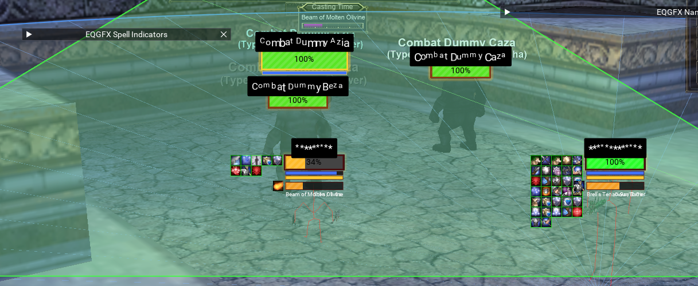
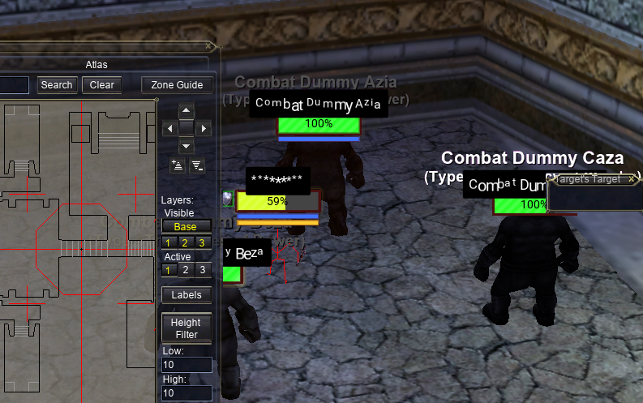
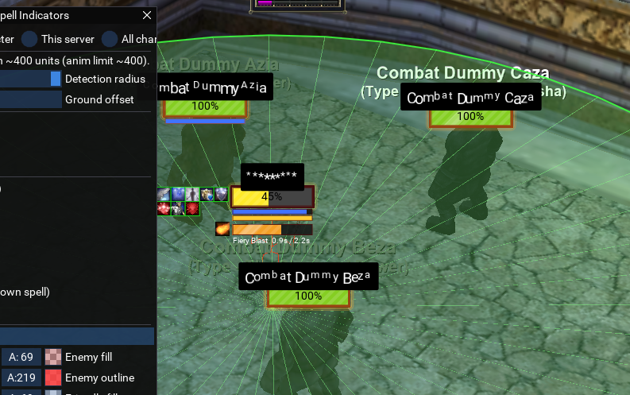
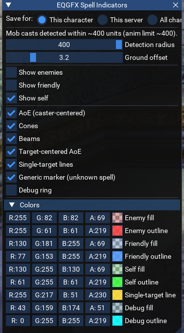

# Getting started

The eqgfx library draws in the EverQuest 3D world from MacroQuest Lua. This
guide takes you from a fresh download to the example scripts (nameplates,
spell area indicators, damage numbers) running and customized. To write your
own scripts, read [CORE_API.md](CORE_API.md).

---

## Requirements

- **MacroQuest** with the **MQEQGFX plugin** built into its tree. Developed and
  tested on the DirectX 11 (live) client; MacroQuest's emu (ROF2, DX9) branch is
  untested, though the core drawing path is expected to work there (see
  [DEVELOPING.md](DEVELOPING.md)).

## Install

Drop the Lua folder into your MacroQuest `lua/` directory:

```
<MacroQuest>/lua/eqgfx/{init.lua, core/, nameplates/, indicators/, ...}
```

and make sure `MQEQGFX.dll` is in your MacroQuest `plugins/` folder. If you
aren't building it yourself, take both the DLL and the `lua/eqgfx/` folder from
the release zip (it unpacks straight into your MacroQuest tree); to build it
from source in the MacroQuest tree, see [DEVELOPING.md](DEVELOPING.md).

## Run

```
/plugin MQEQGFX                the native plugin (loaded once; add it to your
                               autoload list to skip this step)
/lua run eqgfx/nameplates      nameplates + /npmenu settings window
/lua run eqgfx/indicators      AE area indicators + /aemenu settings window
/lua run eqgfx/dmgnums         damage numbers + /dnmenu settings window
```

The scripts auto-load the plugin if it isn't loaded yet. All of them can
run at the same time. Stop one with `/lua stop eqgfx/<name>`. If the
plugin unloads, scripts using it are stopped automatically by MQ2Lua.

---

## Nameplates tour



Every nearby spawn (NPCs, PCs, pets/mercs, optionally yourself, each
toggleable) gets a plate that tracks it frame-accurately:

- **HP bar** with a low→mid→high color gradient (or a fixed color), five
  fill textures (Flat / Gradient / Glass / Stripes / Segmented), optional
  HP % text, and thin mana/endurance bars underneath for the spawns you
  choose (self / group / all PCs / everything).
- **Name text** above, below or inside the bar, with optional shadow,
  background, per-letter animations (wave, bounce, rainbow, typewriter, ...)
  and PC-name anonymization (class name, scramble, asterisks, first+last).
- **Cast bar** under the plate while the spawn casts: spell icon, name, time
  remaining, and interrupt detection. Your own casts come from the client;
  other spawns' casts come from the plugin cast feed when it's available,
  falling back to the "begins to cast" chat line on builds without it.
- **Buff icons** in configurable rows per side (beneficial/detrimental),
  with filters, per-buff size/priority overrides, borders by type or by
  caster, hover tooltips, and right-click spell inspection.
- **Target styling**: your current target's plate can scale up and get its
  own border color and glow.
- **Click to target**: left-clicking a plate targets that spawn by ID. Off by
  default; the toggle is at the top of `/npmenu`. Clicks that belong to an
  ImGui window or a native EQ window are left alone.
- **Animations** everywhere, all optional: fade in/out, damage flash, appear
  pop, HP smoothing, sheen sweeps, low-HP heartbeat, breathing, border glow,
  idle bob. Per-plate phase offsets keep a crowd from pulsing in lockstep.

### Line of sight

`/npmenu` → **Line of sight** limits plates to the spawns you can actually
see. What you deliberately track *because* it's out of sight keeps its plate:
your group, your raid, your extended targets, your pet, your fellowship and
your current target each have their own exemption toggle, and your own plate
is never hidden. A spawn that drops out of sight fades out like anything that
leaves range and pops back when you can see it again.

The visibility raycast isn't free with a crowd in range, so each spawn's
answer is cached; "Re-check every" sets that interval (0.25s by default).

### Crowds: distance scaling, separating, stacking

Three settings deal with a screen full of spawns:

- **Distance scaling** shrinks the whole plate — bar, name, HP %, buff icons
  and cast bar together — from full size at a near distance down to a floor
  at a far one, so a crowd reads as depth rather than a wall of identical
  plates.
- **Overlap → Separate** keeps every plate at its own X and pushes colliding
  ones down until they clear each other.
- **Overlap → Stack** collapses each cluster of plates into a single tidy
  column: the most important plate of the cluster keeps its position and the
  rest line up underneath it. "Cluster radius" is how close two plates have
  to project before they count as the same clump.

Your own plate and your target's are never displaced by either mode.

### Pausing when nothing is on screen

`/npmenu` → **Idle** stops the whole feature while EverQuest isn't rendering
(the frame limiter has stopped drawing the scene) or, optionally, whenever
the window isn't in the foreground. Drawing and the spawn scan both stop;
plates keep their state and come straight back. The same two toggles are in
`/dnmenu` and `/aemenu`.

Only the "not rendering" toggle is on by default: a backgrounded window that
is still rendering is one you may well be watching while boxing.


Everything in `/npmenu` applies instantly and saves automatically.

### Native UI occlusion

Plates never draw over the EverQuest windows. By default they are **clipped**
around every open EQ window (the plate visually slides underneath); you can
switch to hiding the whole plate instead ("Behind-window style" in `/npmenu`).
If some custom window isn't being detected, `/npui` lists what the scan sees
and `/npui add <Name>` adds a window to it (see Troubleshooting below).



### AE cast highlight

While an area spell is being cast by you, another player (or their pet/merc),
or an NPC, the plates of everyone the cast will affect light up:

- Orange (`Will harm`): detrimental AEs mark the caster's enemies. Your PBAE
  marks the NPCs in range; an NPC's AE marks the PCs standing in it, including
  you. NPC AEs never mark other NPCs.
- Light blue (`Will help`): beneficial AEs mark the caster's allies: a
  raidmate's group heal lights up the group members it will reach.

Overlapping AEs stack: one AE shows at 50% intensity, each additional one adds
10%, capped at five. Colors, the stack curve, which sources to watch, and the
tint/border/glow/pulse styling are all in `/npmenu` under "AE cast highlight".



The area shapes mirror what the indicators script draws: caster-centered
rings, target-centered rings, cones and beams, taken from the spell's real
geometry. Two practical limits: a group-target spell from someone *outside*
your group marks nothing (their group roster isn't knowable), and a
target-centered AE from another caster resolves only while you have that
caster targeted.

---

## Indicators tour



While you or nearby spawns cast, the affected area is drawn on the ground:

- **PBAE / caster-centered** spells: a ring around the caster.
- **Targeted AE** spells: a ring around the victim.
- **Cones and beams**: the directional wedge/strip the spell covers.
- **Single-target** casts: a line from caster to target.

Colors are split by who is casting (you / friendly / enemy), each shape type
can be toggled, and the drawings are clipped around open EQ windows so they
stay under the native UI. With EQBC connected, boxes share resolved cast
targets so every client can draw target-centered rings even when it never
targeted the caster.

`/aemenu` opens the settings window.

---

## Damage numbers tour

Floating combat numbers rise from spawns as they take hits: melee, spells,
DoT ticks, heals, and misses each get their own color, size and animation
style (float, arc, fountain, static). Filter by source (you, your pet,
others, incoming) and by kind, scale text with damage, abbreviate big
numbers, show spell names: all in `/dnmenu`. `/dmgnums` toggles the numbers,
and `/dntest` pops one sample of every category over your target for tuning.

Numbers can also shrink with distance (`/dnmenu` → **Distance scaling**),
measured when the number spawns and applied on top of the damage scaling, and
the same **Idle** toggles as the nameplates stop drawing when nothing is on
screen — the combat feed keeps draining while paused, so resuming doesn't
replay a backlog.

---

## Settings and save scopes

Settings persist under `<MQ config>/eqgfx/` as plain Lua files:

| File | Scope |
|------|-------|
| `<Server>_<Name>_settings.lua` | one character (the default) |
| `<Server>_settings.lua` | every character on a server |
| `global_settings.lua` | everything |

All the example scripts share these files (each under its own section), and each menu
has a "Save for: character / server / global" selector at the top. Picking a
broader scope migrates the section so it actually takes effect. Files are
written only when something changed.

---

## Troubleshooting

- **`/npdebug`** prints a full health report: render capabilities, the plugin
  build stamp, the native UI scan state (`ui sweep`, `ui rects` lines),
  buff scan results for your target, any AE areas currently in flight, and
  the state of the idle gate, the line-of-sight filter, distance scaling and
  overlap handling.
  The plugin also has its own `/eqgfx` status line (build stamp, render
  callback health, sweep counters) that works without any Lua running.
- **Plates draw over a window?** `/npui` lists every window the scan sees;
  `/npui show` draws the detected rects on screen. A window the client names
  unusually can be added with `/npui add <Name>` (find names with
  `/windows`).
- **Updating the plugin**: `/plugin MQEQGFX unload`, replace the DLL, then
  `/plugin MQEQGFX`. No game restart needed.
- **No cast bars / indicators for other spawns**: on builds with the plugin
  cast feed live (`eqgfx.start_casting_addr() ~= 0`, i.e. `casts.feed_live()`
  is true), other spawns' casts come from the feed and don't depend on chat. On
  builds without the feed, detection falls back to the "begins to cast" chat
  line — there, make sure those messages aren't filtered off. Either way this
  affects only cast bars and AE/indicator highlights; damage numbers come from a
  separate feed and are unaffected.
