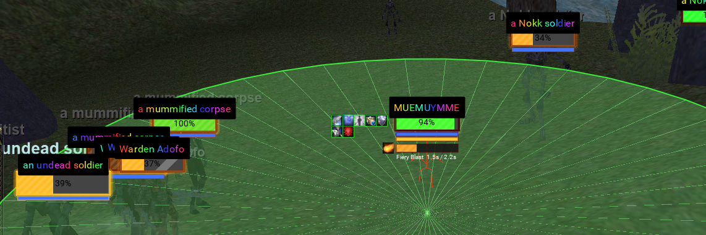

---
tags:
  - plugin
resource_link: ""
support_link: ""
repository: "https://github.com/RedGuides/MQEQGFX"
config: "MQEQGFX.json, MQEQGFX_<class>.json"
authors: "Andrew Cook"
tagline: "3D world drawing for Lua, unit frames, spell animations and hover casting"
---

# MQEQGFX

<!--desc-start-->
MQEQGFX draws in the EverQuest 3D world. It adds unit frames with hover casting, animated spell effects, a target ring and attack indicators, and a Lua module that lets any script project world coordinates to the screen, draw in the world, recolor spawn models and read combat events.
<!--desc-end-->



## Features

* **Unit frames**: player, target, focus (secondary target), group, raid, pet and extended target windows, each with its own options panel. See [Unit frames](unit-frames.md).
* **Hover casting**: `/attarget` runs any target-consuming command (`/cast`, `/alt act`, `/useitem`, ...) at a group member, raid member, extended target, your focus or whatever the mouse is over, without changing your target.
* **Spell animations**: cast, travel, impact and persistent aura animations chosen from what each spell does, for your casts or everyone's.
* **World effects**: a ring under your target, an auto attack indicator, and optional per-class idle animations on nearby spawns.
* **Stock window replacement**: draw selected EverQuest windows (spell gems, hot bars, spell book, inventory, chat and more) with the plugin's own windows, with per-class layouts. See [Stock windows](native-ui.md).
* **Performance options**: batched nametag and UI text drawing, reduced animation rate for distant actors, and particle drawing on the GPU.
* **Lua module**: `require('eqgfx')` for world drawing, projection, model highlighting, spell geometry, cast and damage feeds. See [Lua API](lua-eqgfx.md).
* **Bundled Lua scripts**: nameplates, spell area indicators, floating damage numbers and target highlighting. See [Lua scripts](lua-scripts.md).

## Getting started

```txt
/plugin MQEQGFX
```

The group, focus and extended target windows open on load. `/eqgfx help` lists every command, and `/eqgfx options` opens the plugin options window.

To use the bundled scripts, copy the `lua/eqgfx` folder into your MacroQuest `lua` folder (`<MQ>/lua/eqgfx/`), then run any of them:

```txt
/lua run eqgfx/nameplates
/lua run eqgfx/indicators
/lua run eqgfx/dmgnums
/lua run eqgfx/highlight
```

The scripts load the plugin themselves if it is not already loaded.

### Building

MQEQGFX builds like any other MacroQuest plugin: place the repository under the MacroQuest `plugins` folder (for example as a submodule) and add `MQEQGFX.vcxproj` to the solution, or build it through the CMake project. Its vcpkg dependencies (luajit, sol2, zlib, nlohmann-json) are listed in `vcpkg_mq.txt`. The plugin requires the 64-bit DirectX 11 client.

## Commands

<a href="cmd-eqgfx/">

</a>
:     {{ readMore('projects/mqeqgfx/cmd-eqgfx.md') }}

<a href="cmd-attarget/">

</a>
:     {{ readMore('projects/mqeqgfx/cmd-attarget.md') }}

The bundled Lua scripts add their own commands while they run; see [Lua scripts](lua-scripts.md).

## Settings

Almost everything is set in game, from the unit frame options panels (`/eqgfx uf <window> options`) and the plugin options window (`/eqgfx options`). Changes are saved automatically. All files are in the MacroQuest `config` folder:

| File | Contents |
|------|----------|
| `MQEQGFX.json` | Plugin-wide settings: unit frames, targeting, spell animations, world effects, target ring, attack indicator, performance options, and which stock windows are replaced. |
| `MQEQGFX_<class>.json` | Per-class settings, named by the class short name (for example `MQEQGFX_shm.json`): window positions, button bar layouts, hot buttons, button sets and chat tabs of the replaced stock windows. Every character of that class shares it. |
| `MQEQGFX_layouts/<name>.json` | Saved UI layouts, see `/eqgfx ui layout`. |
| `MQEQGFX_shaders.bin` | Compiled shader cache. Safe to delete; it is rebuilt on the next load. |
| `eqgfx/*_settings.lua` | Settings of the bundled Lua scripts, see [Lua scripts](lua-scripts.md#settings). |

If an older `MQEQGFX.ini` or `MQEQGFX_<class>.ini` exists, it is converted to JSON the first time and left in place.

`MQEQGFX.json` is plain JSON with one object per section:

```json
{
  "SpellFx":    { "Enabled": true, "Scope": 2, "Range": 200.0 },
  "TargetRing": { "Enabled": true },
  "Gfx":        { "ClassFx": false, "NametagBatching": true, "ParticleGpu": false },
  "UnitFrames": { }
}
```

Editing it by hand is not necessary; use the options windows instead.

## Lua

The plugin exposes a Lua module. `require('eqgfx')` (from the bundled `lua/eqgfx` folder) or `require('plugin.MQEQGFX')` returns it:

```lua
local mq    = require('mq')
local eqgfx = require('eqgfx')

assert(eqgfx.init())
while true do
  eqgfx.clear()
  local t = mq.TLO.Target
  if t.ID() and t.ID() > 0 then
    eqgfx.add_circle(t.X(), t.Y(), t.Z(), 15, eqgfx.argb(200, 255, 60, 60))
  end
  mq.delay(50)
end
```

See [Lua API](lua-eqgfx.md) for the full reference.

## See also

- [Unit frames](unit-frames.md)
- [Stock windows](native-ui.md)
- [Lua API](lua-eqgfx.md)
- [Lua scripts](lua-scripts.md)
