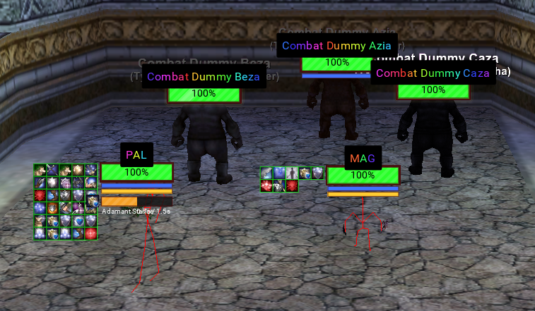
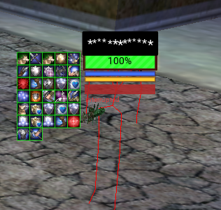
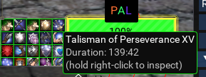
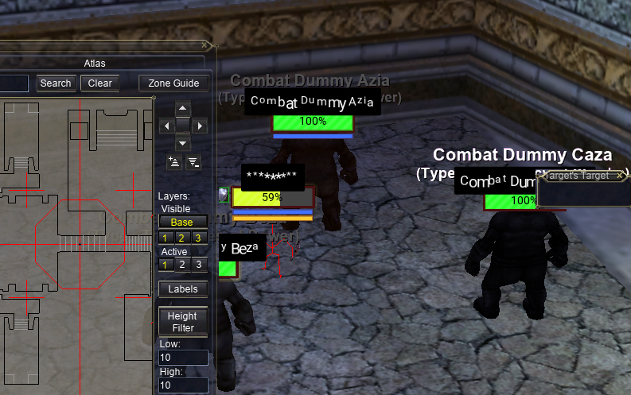
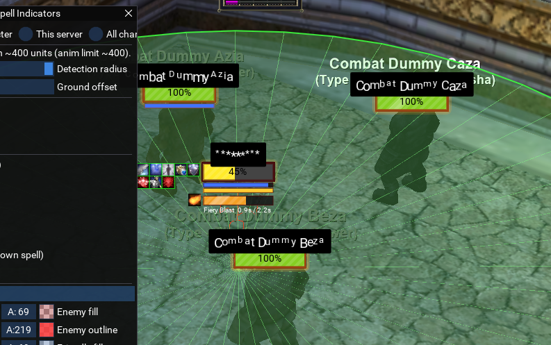
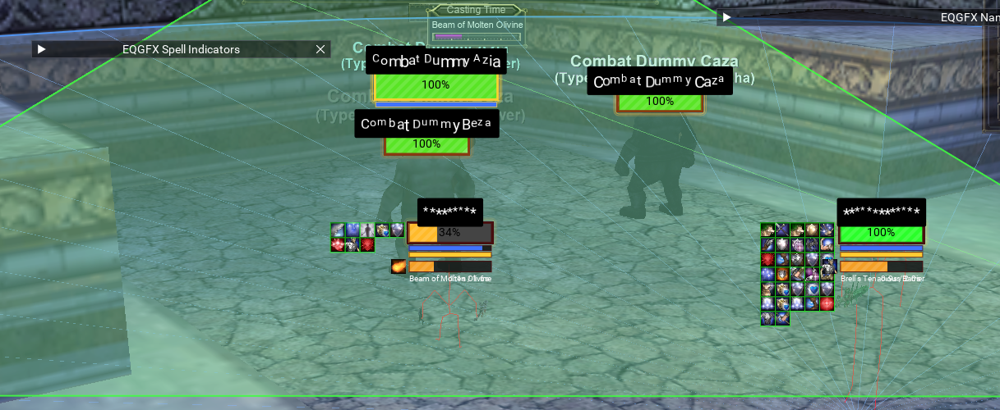
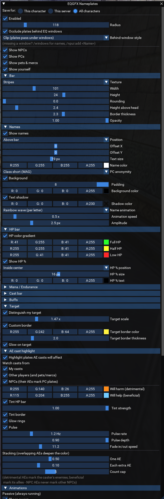
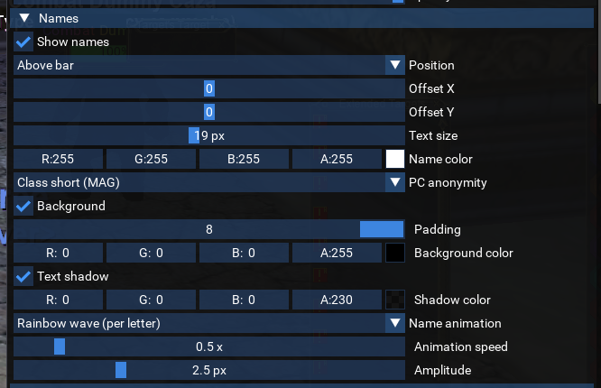
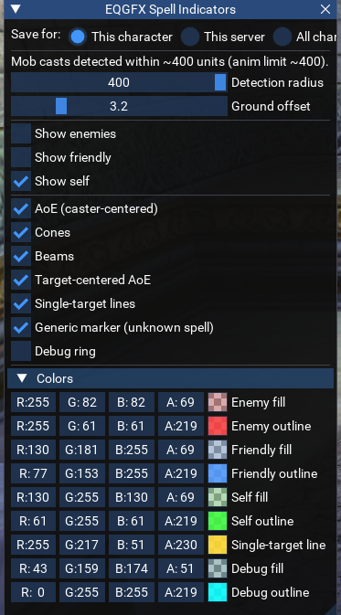

# Lua scripts

Four scripts ship in the `lua/eqgfx` folder. Copy the folder to `<MQ>/lua/eqgfx/`, then run them with `/lua run`:

```txt
/lua run eqgfx/nameplates      nameplates with cast bars, buffs and AE highlighting
/lua run eqgfx/indicators      spell areas drawn on the ground
/lua run eqgfx/dmgnums         floating damage numbers
/lua run eqgfx/highlight       target tinting, role markers and cast animations
```

Each script loads the plugin if needed, and all of them can run together. A script started before you are in game, for example from an autoexec file, waits until you are. Stop one with `/lua stop eqgfx/<name>`. Each has an in-game settings window; every change applies immediately and is saved automatically.

All four scripts stop drawing while EverQuest is not rendering, and can optionally stop while the window is not in the foreground (the **Idle** settings in each menu).

## Nameplates



Nearby spawns (NPCs, PCs, pets and mercenaries, and optionally yourself) get a plate that follows them:

* **Health bar** with a color gradient or fixed color, five fill textures (flat, gradient, glass, stripes, segmented), optional percentage text, and thin mana and endurance bars for the spawns you choose.
* **Name** above, below or inside the bar, with shadow, background, per-letter animations and PC name anonymization.
* **Cast bar** while the spawn casts: spell icon, name, time remaining and interrupts.
* **Buff icons** in rows for beneficial and detrimental effects, with filters, per-buff size and priority, borders by type or caster, tooltips, and right-click-and-hold to inspect a spell.
* **Target styling**: your target's plate can be larger, with its own border and glow.
* **Click to target**: left-clicking a plate targets that spawn (off by default).
* **Animations**: fade in and out, damage flash, health smoothing, sheen, low health heartbeat and more, all optional.





**Line of sight** limits plates to spawns you can see. Your group, raid, extended targets, pet, fellowship and target each have an exemption toggle. **Distance scaling** shrinks plates with distance. **Overlap** handling either pushes colliding plates apart (**Separate**) or collapses each cluster into one column (**Stack**); your plate and your target's are never moved.

Plates are clipped around open EverQuest windows so they pass underneath them, or hidden entirely behind a window (**Behind-window style**). If a window is not detected, `/npui` lists the windows found and `/npui add <Name>` adds one.



### AE cast highlight

While an area spell is being cast, the plates of the spawns it will affect are highlighted: orange for harmful spells (the caster's enemies), light blue for beneficial ones (the caster's allies). Overlapping area spells deepen the color. Colors, sources and styling are under **AE cast highlight** in `/npmenu`.





A group spell from someone outside your group marks nothing, and a target-centered area spell from another caster is resolved only while you have that caster targeted.

### Commands

| Command | Description |
|---------|-------------|
| `/npmenu` | Open or close the settings window. |
| `/npradius <n>` | Set the plate radius. |
| `/nppcs` | Toggle plates on player characters. |
| `/npui` | List the EverQuest windows the plates are clipped around. |
| `/npui show` | Toggle an overlay of the detected window rectangles. |
| `/npui add <Name>` | Add a window to the scan. Find names with `/windows`. |
| `/npdebug` | Print a status report: occlusion, idle state, line of sight, overlap, target buffs and area spells in flight. |





## Indicators

While you or nearby spawns cast, the spell's area is drawn on the ground:

* **Caster-centered** area spells: a ring around the caster.
* **Target-centered** area spells: a ring around the target.
* **Cones and beams**: the area the spell covers in front of the caster.
* **Single-target** spells: a line from caster to target.

Colors are set separately for your casts, friendly casts and enemy casts, each shape can be turned off, and the drawings pass under open EverQuest windows. When EQBC is connected, your characters share the targets of casts they see, so target-centered rings can be drawn even for casters you have not targeted.



### Commands

| Command | Description |
|---------|-------------|
| `/aemenu` | Open or close the settings window. |
| `/aering [radius]` | Toggle a test ring around you, optionally setting its radius. |
| `/aerad <radius>` | Set the test ring radius. |
| `/aez <offset>` | Set how far below the reported position areas are drawn. |

## Damage numbers

Numbers rise from spawns as they are hit or healed. Melee, spells, DoTs, heals and misses each have their own color, size and motion (float, arc, fountain or static). Filter by source (you, your pet, others, incoming) and by kind, scale text with the amount, abbreviate large numbers and show spell names. Numbers can shrink with distance.

This script reads the plugin's damage feed (`poll_damage()`) while it runs; see [Lua API](lua-eqgfx.md#event-feeds).

### Commands

| Command | Description |
|---------|-------------|
| `/dnmenu` | Open or close the settings window. |
| `/dmgnums` | Turn damage numbers on or off. |
| `/dntest` | Show one sample of every number type over your target (or you). |

## Highlight

Four layers of decoration, each turned on and off separately:

* **Model tinting**: your target's 3D model is recolored by what it is: the main assist's target, a player, a pet, an NPC in combat, or an idle NPC.
* **Role markers**: animated markers on the group or raid main tank and main assist.
* **Ambient animation**: an idle animation on every NPC in line of sight, either a signature animation per class in class colors or a random style. Off by default.
* **Cast animations**: every cast is animated according to the spell's area: beams, cones, area rings, or a bolt at the target. Beneficial spells are green; detrimental ones are colored by resist type.

All layers share one drawing budget, served in the order markers, casts, ambient, so a crowded zone thins the decoration first. This script uses the shared primitive scene; do not run it alongside another script that draws with `add_*`.

### Commands

| Command | Description |
|---------|-------------|
| `/hlmenu` | Open or close the settings window. |
| `/hl` | Turn everything on or off. |
| `/hl markers` | Toggle the role markers. |
| `/hl tints` | Toggle model tinting. |
| `/hl ambient` | Toggle the ambient animation. |
| `/hl casts` | Toggle the cast animations. |
| `/hl test` | Draw both role markers on yourself, to preview them without a group. |

## Settings

The scripts save their settings under `<MQ>/config/MQEQGFX/lua/`. Each file is a Lua table with one section per script:

| File | Scope |
|------|-------|
| `<Server>_<Name>_settings.lua` | One character (the default). |
| `class_<CLS>_settings.lua` | Every character of one class, for example `class_SHM_settings.lua`. |
| `global_settings.lua` | Every character. |

Each settings window has a **Save for** selector (this character, this class, all characters). Choosing a broader scope removes the section from the more specific files so the broader one takes effect.

```lua
return {
  nameplates = { radius = 200, ... },
  indicators = { groundOffset = 0, ... },
  dmgnums    = { enabled = true, ... },
}
```

Changes are written half a second after the last edit. Editing these files by hand is not necessary; use the settings windows.

The scripts log to `<MQ>/config/MQEQGFX/eqgfx.log`. When it reaches 1 MB it is moved to `eqgfx.log.old` and a new log starts.

## Troubleshooting

* **Plates draw over a window**: `/npui` lists the windows found, `/npui show` outlines them, and `/npui add <Name>` adds a missing one.
* **No cast bars or indicators for other spawns**: when the plugin's cast feed is not available, other spawns' casts are read from the "begins to cast" chat message; make sure those messages are not filtered.
* **Two scripts sharing a feed**: only one script should read `poll_damage()`. Stop the damage numbers script before running another script that reads it.
